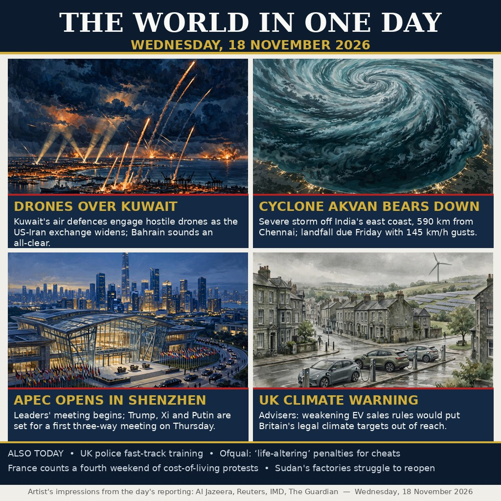

[](https://make.fun/bounty/news-image-20261118?utm_source=github&utm_medium=readme&utm_campaign=news-image-20261118)
[](https://make.fun/bounty/news-image-20261118/leaderboard?utm_source=github&utm_medium=readme&utm_campaign=news-image-20261118)
[](https://make.fun/bounty/news-image-20261118?utm_source=github&utm_medium=readme&utm_campaign=news-image-20261118)

# The World in One Day — Wednesday, 18 November 2026

Entry for the make.fun competition
[news-image-20261118](https://make.fun/c/news-image-20261118):
sum up 18 November 2026's world news in one image.



## What the image shows

A newspaper front page for Wednesday, 18 November 2026, built from four
illustrated panels plus a ticker of further stories reported the same day:

1. **Drones over Kuwait** — Kuwait's air defences engage hostile drones
   early on Wednesday as the US–Iran exchange widens; Bahrain sounds an
   all-clear after a threat alert. (Al Jazeera, Reuters, 18 Nov.)
2. **Cyclone Akvan bears down** — the storm strengthens into a severe
   cyclonic storm off India's east coast, about 590 km from Chennai;
   landfall is forecast for Friday with gusts to 145 km/h. (IMD, 18 Nov.)
3. **APEC opens in Shenzhen** — the leaders' meeting begins; Trump, Xi
   and Putin are set for a first three-way meeting on Thursday.
   (CNA/Reuters, 18 Nov.)
4. **UK climate warning** — the Climate Change Committee warns Britain
   will likely miss its legal climate targets if EV sales rules are
   weakened. (Reuters, 18 Nov.)

Also today: UK police fast-track training to fix leadership; Ofqual
wants "life-altering" penalties for pupils who cheat with tech;
France counts a fourth weekend of cost-of-living protests; Sudan's
factories struggle to reopen after war damage.

The four panels are artist's impressions, drawn from the reported
events; every fact and figure in the captions was checked against
news first reported on 18 November 2026. Stories from earlier days
— the Kerch Bridge strikes, the Manila summits, the Nvidia probe —
were deliberately left out: this page is 18 November alone.

## How it is built

`main.ts` (Node 22, standard library only) copies the composed
`entry.png` to `$MAKEFUN_OUTPUT_DIR/entry.png`. It runs with no
network and writes identical bytes on every run. The front page
itself was composed offline from the four panels with a real font,
so all text in the image is crisp and correct. The file is JPEG
bytes under the `entry.png` name, which the competition rules
allow — the gate tells PNG from JPEG by the first bytes — because
the photo-heavy page is far over the 1 MiB cap as PNG.

Run it locally:

```sh
mkdir -p out && MAKEFUN_OUTPUT_DIR=out node main.ts
```

## License

MIT — see [LICENSE](LICENSE).
